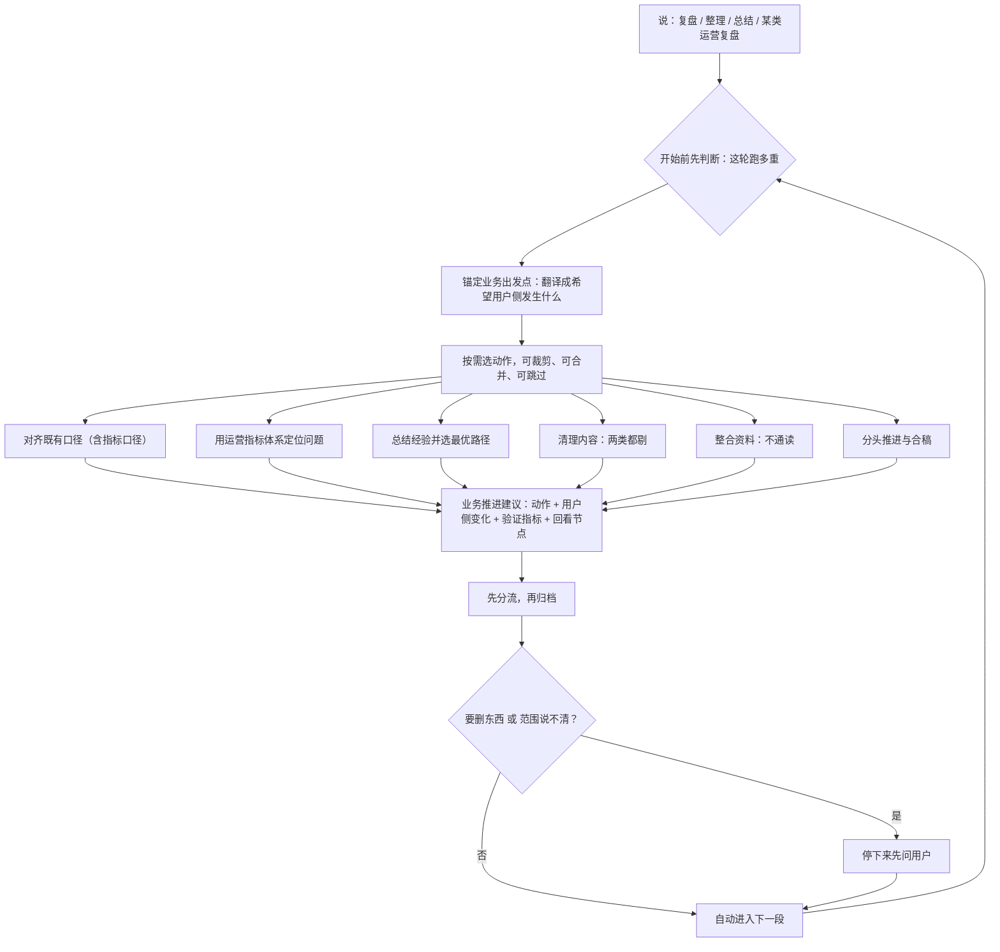
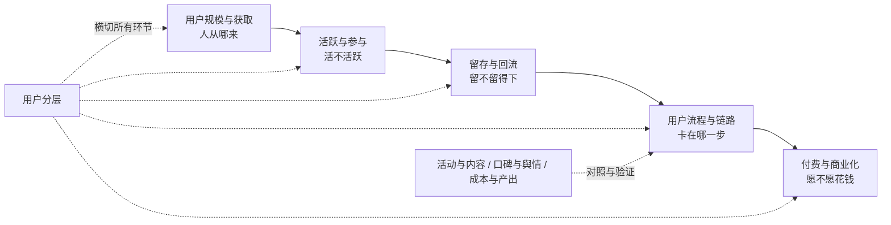
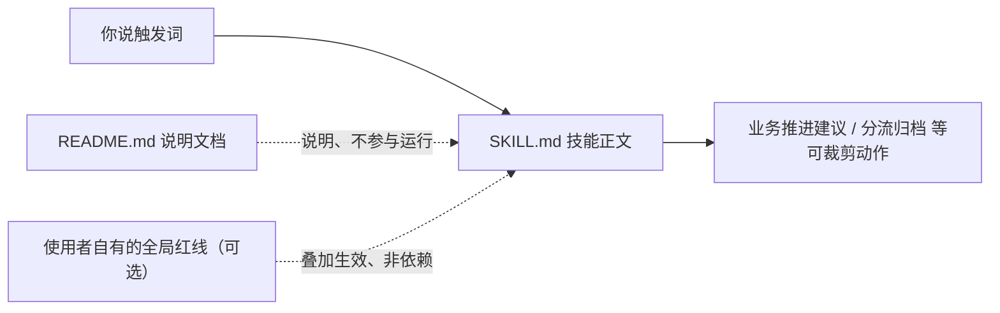

# retrospective｜游戏运营工作复盘技能

> **一句话**：这是一个装在 兼容的 AI 助手 里的「复盘操作手册」。你说一句「复盘 / 整理 / 总结」，它就按一套**弹性框架**帮你把游戏运营的一次动作（版本、活动、投放、渠道……）复盘清楚，而且**从业务目的出发、落到用户侧、最后推到「下一步做什么」**，不是只把资料整理好看。

> 图示约定：本文的流程图用 Mermaid 语法画。用支持 Mermaid 的 Markdown 编辑器或代码托管平台打开即可直接看图；纯文本查看器会显示成文字代码，不影响阅读。
>
> **本文件为「分发版」说明**：包内只含 `SKILL.md`、`README.md` 和 `LICENSE`，已做两件事——① 把原本指向外部规矩文件的做法要点**内联进正文**，开箱即用、不依赖任何本机文件；② 去掉称呼、内部路径与内部变更史等线索。自用版另含本机挂接信息，不在本包内；两版框架与三条底线完全一致。

> **场景模板**：本文中的版本、活动、投放、渠道、指标与归档位置都是可裁剪的游戏运营复盘场景，不对应任何具体游戏、公司或客户。安装根目录使用 `{{SKILL_ROOT}}` 占位符表示。

---

## 0. 先看结论（30 秒）

- **它是谁**：一个用户级技能，名字叫 `retrospective`，管「复盘 / 整理 / 总结」这类活儿，2026-11-12 起专门优化成**游戏运营工作复盘的通用版本**。
- **「通用」指什么**：不限定某款游戏、某个渠道、某类活动——版本复盘、活动复盘、投放复盘、渠道复盘、数据复盘都能用同一套框架，具体看哪些指标、跑几步，按当次情况自己定。
- **它最特别的一点**：**从业务目的出发，且把业务目的翻译成「希望用户侧发生什么变化」**。你说「想提升活跃」，它不会只盯着 DAU 数字，而是顺着「用户从哪来 → 活不活跃 → 流程走不走得通 → 留不留得下」去找卡点，最后给能推动业务的动作。
- **它不写死**：只有 3 条底线是硬的，其余都是「可裁剪的动作清单」，按任务大小挑着用。
- **它不做什么**：不改你的原表 / 在线表；不擅自删任何东西（要删先问你、文件只进回收站）；不当场给效果下结论。

---

## 1. 这个技能是干什么的（作用）

### 1.1 定位

把游戏运营相关的复盘、整理、总结类任务，按一套**弹性框架**推进：**先判断，再按需选动作，收口即进下一段，全程朝「下一步业务动作」推进**。

三条主线：

| 主线 | 大白话 |
|---|---|
| **以业务目的为出发点，且落到用户侧** | 先弄清这次要推动什么业务目标，再翻译成「希望用户侧发生什么变化」——更多用户活跃、更顺的用户流程、更高留存或转化。业务目的本身就是用户视角的，不只盯内部数据 |
| **用运营指标体系定位问题，不当报表填** | 指标是找差距、找卡点的「镜头」，按业务目的挑相关的用，不是每格必填的表 |
| **收口要能推动业务** | 结论要落到「下一步做什么动作、看哪个用户侧指标验证、什么时候回看」，而不是把资料归好档就算完 |

> 名词随文：**用户侧**＝玩家这一端真实发生的事（有多少人来、活不活跃、流程走不走得通、留不留得下）；**卡点**＝用户在流程某一步大量流失或走不下去的地方；**口径**＝一个数字是怎么算出来的（统计时间段、分母是谁、算不算某个渠道、去没去重）。

### 1.2 和「旧版通用复盘」比，这次改了什么

旧版是**通用的资料整理复盘**（对齐 → 总结 → 清矛盾 → 归档）。这一版定位为**游戏运营工作复盘通用版**，四个变化：

| 维度 | 旧版 | 本版（游戏运营通用版） |
|---|---|---|
| 出发点 | 直接对齐既有结论、收资料 | **先锚定业务目的，并落到用户侧**（用户活跃、规模、留存、流程顺畅度） |
| 专业抓手 | 无行业框架 | **补一套完整运营指标体系**，作为可选镜头定位问题 |
| 收口产出 | 分流归档 | 新增**「业务推进建议」**：下一步做什么、看哪个指标验证、何时回看 |
| 触发场景 | 复盘 / 整理 / 总结 | 追加**版本 / 活动 / 投放 / 渠道 / 数据复盘**等游戏运营触发词 |

**没变**：三条底线、「先判断再选动作」的弹性结构、单文件、不装任何依赖、「不写死」——这些是刻意保留的设计。

### 1.3 它解决什么问题

| 没有它时容易出的状况 | 这个技能怎么兜住 |
|---|---|
| 复盘写成流水账，看完不知道下次该做什么 | 必须给「下次走哪条最省事」的一条推荐 + 落地动作 |
| 只报数字不问用户 | 业务目的一律翻译成「希望用户侧发生什么」，指标围着用户找卡点 |
| 一堆指标平铺，看不出重点 | 按业务目的挑 2–3 组镜头深看，其余只登记不深挖 |
| 这次说的和上次口径对不上，各写各的 | **先对齐**：结论、记录、指标口径先摆出来比对 |
| 前后矛盾、为凑篇幅硬塞的内容混在里面 | **两类都剔**：自相矛盾的、凑数拼凑的，剔了还记一笔 |
| 一堆资料从头读到尾，费时还抓不住重点 | **不通读**：先建地图（只登记元信息）→ 按需取用 → 每步留痕 |
| 结论一股脑塞进「归档」，过两周没人翻 | **先分流再归档**：先问「这条以后归谁管」，再决定去向 |
| 攒一大堆「待办经验」，一条没落地 | **限量 + 要落地动作**：写不出「下一步具体怎么做」的算感想、不算经验 |
| 多个小帮手分头干，合稿时口径打架 | **合稿前先互相对齐再收口**，每块产出带出处 |
| 复盘完只交一份文档，业务没动 | **业务推进建议**：动作 + 预期用户侧变化 + 验证指标 + 回看节点 |

### 1.4 三条底线（唯一写死的地方）

整份技能只有这三条是硬要求，其余全可裁剪——这正是「不写死」的落点。

| # | 底线 | 大白话 |
|---|---|---|
| 1 | **先对齐** | 动手前把以前定过的结论、记录、口径摆出来对一遍；指标口径（统计周期、分母、渠道归因、是否去重）尤其要先对齐，不然数字没法比 |
| 2 | **每步留痕** | 每条结论、每个数字都能追回出处（哪份资料、怎么取的、是否加工过），加工过的保留中间产物，不凭记忆复述 |
| 3 | **删前先问** | 反复核实确认某条归档信息无用后，先列出要删的、向你确认，同意再删；实体文件一律不直接删，只进回收站 |

### 1.5 它不做什么（边界）

- **不替你做决定**：要删东西、范围说不清，一定先问你。
- **不覆盖全局红线**：文件删除规则、不修改原表、往公开仓库发布前先审后传等，照常叠加生效。原表 / 在线表一律只读。
- **不当场判效果**：刚收口时结果往往还没落地，当场下结论容易看错，需要时隔一轮再回看。
- **不硬啃全部**：范围过大时先切一片做（从当下最关心的那块切入），剩下的登记在地图上留下一轮。
- **你说跳过就跳过**：明确说「不走流程 / 直接改」，就尊重你，跳过整套框架。
- **不是填表工具**：指标体系是镜头不是必填清单，不要求每次凑齐所有指标。

---

## 2. 怎么用（用法）

### 2.1 触发方式

不用记命令、不用点按钮，**说出触发词即可**：

> 复盘、整理、总结、回顾、梳理、汇总、沉淀经验
> 以及游戏运营场景词：版本复盘、活动复盘、投放复盘、渠道复盘、数据复盘

意思相近的话也算。任务很小、资料很少时仍会加载，但允许把流程压缩成一两轮——不会为了走流程而走流程。

### 2.2 最简用法

```
帮我复盘一下这次新版本的玩家留存
```

一句话就够。技能会先判断这轮跑多重、锚定业务目的，再决定启用哪些动作。

### 2.3 典型场景示例

| 你可以这样说 | 技能大致怎么跑 |
|---|---|
| 「复盘一下这次版本更新，看新手期为什么留不住人」 | 锚定「让新玩家顺利过完新手期」（用户侧）→ 挑留存 + 用户流程链路镜头 → 找卡点 → 给改哪一步的业务推进建议 |
| 「整理一下这次投放的几个渠道数据」 | 先建地图不通读 → 对齐渠道归因口径 → 看规模 / 成本产出镜头 → 分流归档 |
| 「总结一下这个活动的参与情况」 | 对齐活动目标 → 活动与内容 + 用户分层镜头 → 剔矛盾与凑数 → 经验 + 推进建议 |
| 「沉淀一下这次渠道发行的经验」 | 重点在经验条目：带「为什么 + 下一步具体怎么做」，事实 / 推测 / 判断分开，按任务大小限量 |
| 「资料很多，分头整理再合起来」 | 判断有可并行拆开的块 → 派多个子 agent 分头做 → 合稿前先互相对齐再收口 |

> 名词随文：**子 agent**＝可以派出去分头干活的小帮手，几个同时做不同的块，最后合稿。技能里写的是「允许、非必须」，不是每次都派。

### 2.4 一个端到端示例（看清「用户出发点 → 业务推进」怎么落地）

场景：某游戏新版本上线后，7 日留存掉了。

```
① 锚定业务出发点
   业务目的「挽回留存」→ 翻译成用户侧的一句话：
   「希望新玩家能顺畅走完注册→创角→新手引导→首局，并愿意第 2 天、第 7 天回来」

② 先判断这轮跑多重
   资料量中等、口径可能不一致、无可并行块 → 跑一轮标准流程，不派子 agent

③ 先对齐
   把上次的留存口径（分母是新增注册还是激活设备？是否按渠道去重？）统一

④ 挑指标镜头定位问题（只挑相关的 2–3 组）
   留存与回流 + 用户流程与链路 + 用户分层
   → 发现：新手引导第 3 步转化率明显低于其他步骤，且某渠道来的用户掉得更狠

⑤ 总结经验 + 选最优路径
   经验：该渠道新手引导第 3 步存在卡点（事实）；推测是引导文案与该渠道用户画像不匹配（推测）
   推荐：优先改第 3 步引导，而不是全量重做新手（别的路成本高、见效慢）

⑥ 业务推进建议（收口主要产出）
   - 动作：简化新手引导第 3 步，针对该渠道做一版引导文案
   - 预期用户侧变化：第 3 步完成率提升，新玩家更顺地进首局
   - 验证指标：第 3 步转化率、次日 / 7 日留存，与本次基线比
   - 回看节点：下个版本上线一周后（不当场判效果）

⑦ 先分流，再归档
   跨项目口径 → 全局规矩本子；本次结论 → 项目日志；
   发现某技能该改 → 记一笔；「不用改」也明确记

⑧ 收口，自动进入下一段
```

注意这条链：**每一步都回到「希望用户侧发生什么」这句暗线**，没用的不深挖，最后一定要落到能推动业务的动作。

### 2.5 想跳过流程 / 界面看不到

- **跳过**：直接说「别走流程，直接帮我改」「不用复盘，按我说的做」，就跳过整套框架。
- **技能面板里看不到？** 这是面板缓存问题，不是没装上（实际踩过一次）：新装技能、部分老技能都可能暂时不显示，但功能已生效。验证办法：面板搜索框输入 `retrospective` 或「复盘」；关掉面板重开；必要时重启 兼容的 AI 助手；或到「管理技能」已安装列表看。**就算不显示，直接说「帮我复盘 xx」照样按这个技能走。**

### 2.6 只有两种时刻会停下来问你

按设计，一段收口后**自动进入下一段，中途不停**。例外只有两个：① 要删东西；② 范围明显说不清。另外分流写入某个位置前会先确认有没有授权，拿不准或涉及删除也先问。

---

## 3. 工作流

### 3.1 全景图

> 图里列的是**全部可选动作**，实际每轮按需取用，不是每轮都全跑一遍。



三条底线（先对齐 / 每步留痕 / 删前先问）贯穿全程，不因动作裁剪而省略。

### 3.2 第 0 步：开始前先判断

不套固定档位，按现场情况判断五件事：

1. 任务规模与资料量 → 决定跑几轮、要不要建完整资料地图。
2. 有没有已有结论或口径需要先对齐，对不上的有多少。
3. 有没有能拆开并行处理的块 → 据此决定要不要派多个子 agent（允许、非必须）。
4. 范围是否清楚 → 不清楚就先确认，别默认「全都要」。
5. **这次的业务目的是什么、能否落到一句用户侧的话。**

资料少、任务小可压缩成一两轮，但三条底线不省。

### 3.3 先锚定业务出发点（本技能的主线，不是必答问卷）

引导说清这次要推动什么业务决定 / 目标，并翻译成「希望用户侧发生什么变化」：

- 业务目的本质上是用户视角的：想让更多用户活跃、让注册到首局这条流程更顺、让留存或付费转化更高、让某个渠道来的用户质量更好……用「希望用户怎样」表述，比只写「提升 XXX 指标」更能对准问题。
- 引导方式按现场判断：可以一句话确认，也可以从已有资料里推断。**说不清就按已有信息先推进，不硬问、不卡住**，等出现分歧再回来确认；范围明显不清才停下来问。
- 把这句话当全程暗线：后面每个动作都问「这对那个用户侧目标 / 下一步业务动作有什么用」，没用的不深挖。

### 3.4 可裁剪动作清单（按需取用，不强制顺序）

以下是「动作库」，不是编号步骤。**判断「不做哪些」往往比按清单全跑一遍更省事。**

| 动作 | 做什么 | 关键点 |
|---|---|---|
| **对齐既有口径** | 摆出既有结论、记录、口径逐条比对，标出冲突先处理 | 指标口径不一致先统一再比大小；顺带翻上轮行动项「做了没」；效果判断延后 |
| **用运营指标体系定位问题** | 按第 4 节的镜头挑相关的 2–3 组深看，找差距、找卡点 | 每个数字带口径、时间窗、出处；其余登记不深挖 |
| **总结经验并选最优路径** | 给「下次走哪条最省事」的一条推荐 + 别的路为什么不划算 | 每条带「为什么 + 下一步具体怎么做」；说清预计影响哪个用户侧指标 / 哪段流程；一般十条以内（软上限）；事实 / 推测 / 判断分开标注 |
| **清理内容：两类都剔** | 剔掉自相矛盾的、凑数硬塞的 | 只留能对齐、有出处的；剔了什么记一笔，不悄悄抹 |
| **整合资料：沿用不通读做法** | 不要通读 → 先建地图（只登记元信息）→ 按需取用 → 每步留痕 | 四步要点已内联在正文，自包含、不依赖外部文件 |
| **业务推进建议** | 把结论收成少数几条能推动业务的动作 | 每条写清：做什么、预期用户侧变化、看哪个指标验证、何时回看；按影响面排序；写不出落地动作的不进这节 |
| **归档收口：先分流，再归档** | 先问「这条以后归谁管」再决定去向 | 见 3.5 |
| **分头推进与合稿** | 任务大且能拆时派多个子 agent | 合稿前必须先互相对齐再收口，每块带出处 |
| **收口后进入下一阶段** | 上一段收口即自动进下一段 | 例外：要删东西、范围明显说不清 |

### 3.5 归档分流：先问「这条以后归谁管」

常见去向仅供参照，按实际情况取舍，**不必逐条对照**：

- 跨项目都该守的 → **全局规矩本子**
- 只跟这个项目有关的 → **项目日志**
- 发现某个技能写错或不够用的 → **记下要改哪个技能、改什么**
- 只需留个底的事实 → **归档备查**
- **「不用改」也是一个有效结论**，明确记一笔即可

分流前先确认目标位置是否已有授权；拿不准或涉及删除的，按「删前先问」先问用户，不擅自写入。

### 3.6 与其他规矩怎么叠加

- 全局“文件删除规则”“不修改原表”“往公开仓库发布前先审后传”等红线**照常生效，叠加、不互相覆盖**。
- 「删前先问」与全局删除规则一致，**不得因阶段自动推进而绕过**。
- 阶段自动推进 ≠ 可以跳过对齐，也不等于可以自作主张删东西。
- 原表 / 在线表一律只读，取数用于复盘而不改动源数据。

---

## 4. 完整运营指标体系（可选镜头，挑相关的用）

> **重要**：这是「镜头清单」，不是必填报表。按这次的业务目的挑 2–3 组深看，其余登记在地图上即可，不要求逐项跑一遍、不要求凑齐所有指标。每个数字都带口径、时间窗和出处（留痕）。遇到清单没覆盖的指标（如某玩法专属指标），自行补进对应组并留痕。

体系按**用户生命周期**组织——从「人来」到「人活跃」到「留下来」到「愿意花钱」，这样才对得上「用户出发点」。



| # | 镜头 | 看什么（大白话） | 常见指标 |
|---|---|---|---|
| 1 | **用户规模与获取** | 人从哪来、来得多不多、贵不贵 | 预约、新增注册、下载、激活、渠道来源结构、CPA（获客成本）、曝光→点击→下载转化 |
| 2 | **活跃与参与** | 来了的人活不活跃 | DAU / MAU、登录频次、在线时长、PCU / CCU（同时在线）、活跃率 |
| 3 | **留存与回流** | 留不留得下、走了能不能拉回 | 次日 / 7 日 / 30 日留存、流失、沉默用户、回流 |
| 4 | **用户流程与链路** ⭐ | 用户到底卡在哪一步、为什么走不下去 | 注册→创角→新手引导→首局→核心玩法解锁→社交 / 首次付费，逐环节转化率、漏斗流失点、加载 / 崩溃 / 排队等体验阻塞 |
| 5 | **付费与商业化** | 愿不愿意花钱、花多少、能花多久 | 付费率、ARPU、ARPPU、LTV、首充、复购、付费分层 |
| 6 | **用户分层** | 哪群人好、哪群人差，差距是不是被平均数盖住了 | 新老回流、渠道 / 区服 / 平台、玩法偏好、价值分层（大 R / 中 R / 小 R / 免费用户） |
| 7 | **活动与内容** | 这次动作本身有没有人买账 | 参与率、任务完成率、奖励核销、活动前后对比、版本节点表现 |
| 8 | **口碑与舆情** | 用户嘴上怎么说、和数据对不对得上 | 评分、评论主题、NPS、投诉、社区 / 社群反馈 |
| 9 | **成本与产出** | 钱花得值不值 | 预算、ROI / ROAS、单用户成本、资源位与素材（CTR / CVR） |

⭐ **第 4 组「用户流程与链路」最贴「用户出发点」**，是把「想提升某个指标」变成「用户到底卡在哪」的关键，通常优先深看。

用法要点：**先由业务目的挑 2–3 组重点镜头定位差距 → 顺着用户流程 / 链路找卡点 → 最后才看成本产出**。指标是找问题的镜头，不是必须填满的表。

### 4.1 指标名词小抄（给不熟悉运营术语的人）

| 名词 | 大白话 |
|---|---|
| DAU / MAU | 日活跃 / 月活跃用户数：一天 / 一个月里有多少人来玩过 |
| PCU / CCU | 最高 / 当前同时在线人数：同一时刻服务器里挤了多少人 |
| 次日 / 7 日 / 30 日留存 | 今天新来的人里，第 2 天 / 第 7 天 / 第 30 天还有多少回来 |
| 漏斗 / 转化率 | 用户一步一步走下去，每步还剩多少人的比例；掉得最狠那步就是卡点 |
| ARPU / ARPPU | 平均每个用户 / 平均每个付费用户花了多少钱 |
| LTV | 一个用户从来到走，一辈子大概贡献多少收入 |
| CPA | 拉来一个新用户平均花了多少钱 |
| ROI / ROAS | 花出去的钱赚回来多少；ROAS 更偏「投放花费带回多少收入」 |
| CTR / CVR | 看到素材后点进来的比例 / 点进来后完成目标（如下载、注册）的比例 |
| NPS | 用户愿不愿意把游戏推荐给别人的打分，衡量口碑 |
| 大 R / 中 R / 小 R | 按充值金额把付费用户分的高 / 中 / 低档；免费用户是完全不花钱的 |
| 归因 | 一个新用户算成是哪个渠道带来的，口径不统一就没法比渠道好坏 |
| 口径 | 一个数字怎么算的（统计时间段、分母是谁、算不算某渠道、去没去重） |

---

## 5. 为什么「不写死」（设计原则）

一条核心设计原则：**技能不要一开始就把规则写死，要留出自适应的空间**。落地方式：

| 做法 | 具体体现 |
|---|---|
| 开头先判断，不下令 | 先评估任务规模、资料量、可并行块、范围清晰度、业务目的，再决定跑几步 |
| 只写死 3 条底线 | 先对齐 / 每步留痕 / 删前先问，其余全部可裁剪 |
| 动作写成清单，不编号、不强制顺序 | 「可裁剪动作清单」，允许合并、跳过、补动作 |
| 业务出发点不做成必答问卷 | 说不清就按已有信息先推进、不硬问，范围明显不清才停 |
| 指标体系是镜头不是报表 | 挑 2–3 组深看，其余登记即可；清单可扩展、可增删 |
| 数量用软上限 | 「一般控制在十条以内」，按任务大小自行增减 |
| 分流去向只是参照 | 「常见去向仅供参照，不必逐条对照」 |
| 写明「不做哪些」 | 判断「不覆盖什么」比按 1→2→3 全跑更聪明 |
| 留未来口子 | 拿到历史记录或新用例再补做法，不改框架；你说跳过就跳过 |

**单一来源原则**：流程正文只在 `SKILL.md` 存一份，避免多处各存一份、以后改一处忘另一处而自相矛盾（这正好是技能自己要剔的「矛盾内容」）。本 README 是给人看的说明文档，**不参与技能运行，与 `SKILL.md` 有出入时以 `SKILL.md` 为准**。若使用环境另有自己的规矩体系，由使用者自行挂接，本包不强依赖。

**借鉴来源（2026-11-12 调研结论）**：参考过公开复盘方法与既有技能库，得到结论：热度不等于适用。多数公开方案服务多人回顾会或生产事故复盘，与本技能“AI 复盘资料和工作会话”的对象不同，因此没有照搬任何格式库、投票器、计时器或后台钩子。只吸收了四条通用机制：结论先分流去向、经验带“为什么 + 落地动作”并限量、复查上轮行动项且延后判效果、写明“不做什么”与切片先行。**没有新增任何依赖、脚本或服务，也未复制第三方内容。**

---

## 6. 项目架构

### 6.1 文件结构

技能包**自包含、极简**：只有 `SKILL.md`（流程正文）、`README.md`（本说明文档）和 `LICENSE`（MIT 许可），无脚本、无外部依赖、无需安装。分发版已把原本指向外部文件的做法要点内联进正文，装到别的机器也能直接跑。

```
{{SKILL_ROOT}}/
└── retrospective/
    ├── SKILL.md        ★ 技能正文（唯一权威，AI 加载的就是它）
    ├── README.md       ★ 本说明文档（给人看，随包分发）
    └── LICENSE         MIT 许可证
```

> 名词随文：**用户级技能目录**＝`{{SKILL_ROOT}}/`，装在这里的技能所有项目都能用（相对「项目级」只在单个项目生效）。Windows 上通常是 `{{SKILL_ROOT}}/`。

**关于「挂接」**：技能本身不依赖任何外部文件。若使用环境另有一套自己的全局规矩或资料整合约定，可自行叠加生效，但那是使用者的可选配置，不在本包内、也不是运行前提。

### 6.2 每个文件的职责

| 文件 | 角色 | 谁改它 |
|---|---|---|
| `retrospective/SKILL.md` | **唯一正文**：定位、三条底线、判断维度、业务出发点、动作清单、指标体系、自适应留白、沿革 | 改技能就改这里 |
| `retrospective/README.md` | 给人看的说明文档，不参与技能运行 | 独立维护，与正文有出入以 SKILL.md 为准 |
| `retrospective/LICENSE` | MIT 许可证与版权声明 | 仅在版权或许可选择变化时修改 |

包内就这三个文件，无第三方文件、无脚本、无备份目录。维护时守住“单一来源”：正文只改 `SKILL.md` 一处。

### 6.3 挂接关系图



> 本包自包含：`SKILL.md` 单文件即可运行。虚线的「使用者自有规矩」是可选叠加项，缺失不影响使用。

### 6.4 一条结论的生命周期

```
锚定业务目的（翻译成希望用户侧发生什么）
   → 先对齐（含指标口径，标冲突）
   → 挑指标镜头定位差距与卡点
   → 分类：事实 / 推测 / 主观判断，各自标注
   → 剔掉矛盾与凑数内容（剔了记一笔）
   → 带「为什么 + 下一步具体怎么做」写成经验，限量
   → 收成业务推进建议（动作 + 用户侧变化 + 验证指标 + 回看节点）
   → 先分流：这条以后归谁管？
   → 落到：全局规矩本子 / 项目日志 / 待改技能 / 归档备查 / 「不用改」
   → 每步留痕，可追回出处
```

---

## 7. 分发与安装（压缩包里有什么）

本仓库可直接作为技能包使用，目录结构如下：

```
retrospective-游戏运营复盘技能-分发版.zip
└── retrospective/
    ├── SKILL.md      技能正文
    ├── README.md     本说明文档
    └── LICENSE       MIT 许可证
```

**怎么装（给别的机器 / 分发用）**：把解压出来的 `retrospective/` 整个文件夹，放到目标机器的用户级技能目录 `{{SKILL_ROOT}}/` 下即可，无需运行任何脚本、无需安装依赖。在 Windows 上通常是 `{{SKILL_ROOT}}\`。

**自检清单**：目录里有 `SKILL.md`（带 frontmatter 的 `name` / `description` / `agent_created: true`）→ 说一句「复盘」看会不会触发 → 技能面板可能有缓存，不显示不代表没生效（见 2.5）。

---

## 8. 版本与沿革

| 日期 | 版本事件 | 改了什么 / 依据 |
|---|---|---|
| 2026-11-10 | 立为弹性框架 | 确定触发词、剔除范围、删除边界、阶段推进方式与「留自适应空间」；弹性结构 + 3 条底线 + 可裁剪动作清单 |
| 2026-11-12 | 四处优化 | 参考公开高星复盘项目与既有技能库，只吸收四条纯文字机制：结论先分流 / 经验带「为什么 + 落地动作」并限量 / 复查上轮行动项且延后判效果 / 写明不做什么与切片先行。三条底线与弹性结构未改动 |
| 2026-11-12 | 增补为游戏运营复盘通用版（本版） | 从业务目的出发且落到用户侧、补完整运营指标体系为可选镜头、新增「业务推进建议」收口、扩展游戏运营触发词；三条底线与「不写死」结构不变 |
| 2026-11-12 | 产出分发版 | 做法要点内联进正文（去掉外部文件依赖）、去除称呼与内部路径等线索，独立打包；自用版保留本机挂接信息，不外发 |

> 技能正文 `SKILL.md` 末尾也有一段「沿革」说明，记着框架的历次演进，与本表互相印证。本表只保留方法层面的演进，不含本机文件与备份记录。

## 9. 维护与注意事项

1. **改前先备份**：动 `SKILL.md` 前先复制一份备份，用新名字、不覆盖旧备份。
2. **只改一份**：流程正文只在 `SKILL.md`，不要把正文复制到别处另存一份。
3. **别把弹性写硬**：新增内容尽量写成判断提示或可选动作，不要新增「必须按 1→2→3」的编号步骤；三条底线不要随意增加。
4. **指标体系可增删**：按游戏类型、品类、渠道和业务目的补镜头，但保留「可选、不强制」的定性。
5. **不碰业务资料**：这是流程技能，全程只读复盘所需的资料与记录；原表 / 在线表一律只读不改。
6. **删除红线不破**：任何删除先问你，实体文件只进回收站；「阶段自动推进」不能当理由绕过。
7. **口径提醒**：口径不统一的数字不可直接比大小，先对齐再分析；这是游戏运营复盘最常见的坑。
8. **口径提醒（调研）**：公开代码托管接口可能限流，不同统计页面的数据也可能冲突，本文档因此不写具体热度数字，只保留可复用机制结论，避免把不确定数字固化下来。

---

*本文件是说明文档，不参与技能运行。技能的唯一权威正文是同目录下的 `SKILL.md`；若两者有出入，以 `SKILL.md` 为准。*
